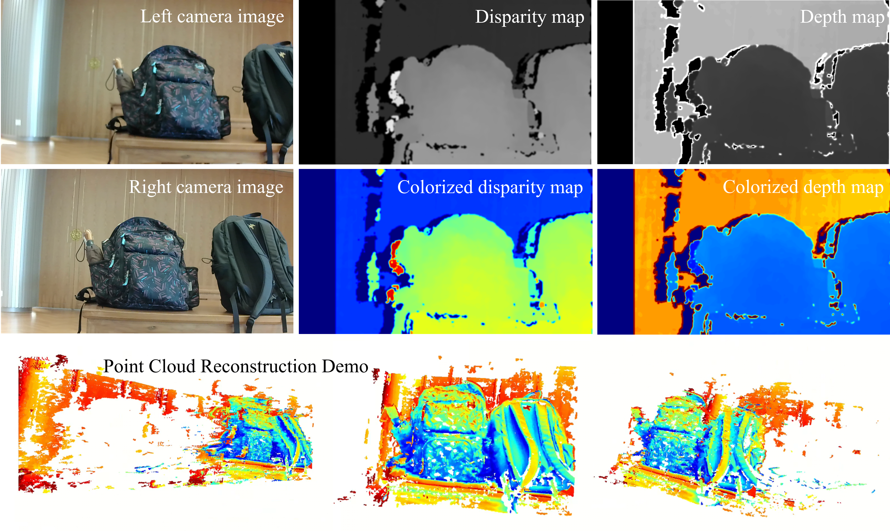

# Stereo Camera: Real-Time Depth and 3D Reconstruction

A stereo vision project built with an **HBVCAM-W202011HD V33 stereo camera**, covering image acquisition, camera calibration, stereo matching, real-time depth estimation, and dense 3D point cloud generation.

The project compares **Block Matching (BM)** and **Semi-Global Block Matching (SGBM)** for disparity estimation and reconstructs 3D points through back-projection. Object length measurement errors were below 10% in the project experiments.

## Results

